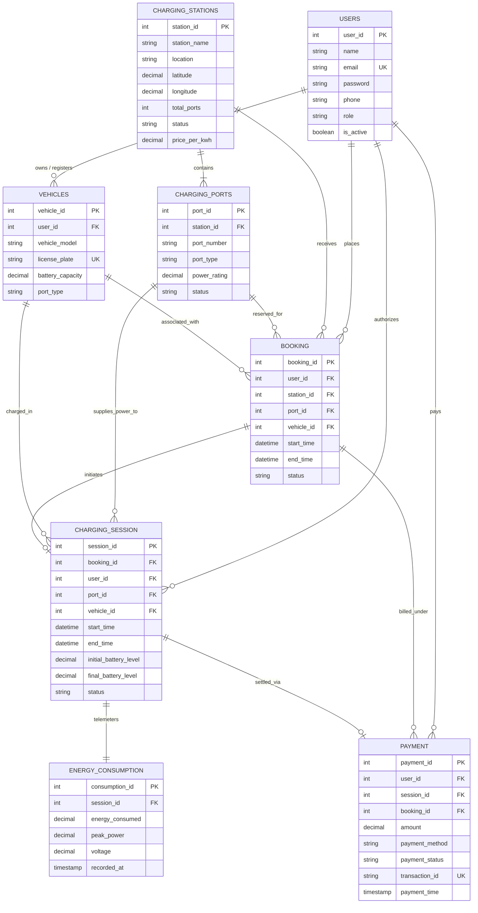

# Smart EV Charging Management System
## Advanced Database Management System (ADBMS) Project Report

---

**Project Title:** Smart Electric Vehicle (EV) Charging Management System  
**Course/Domain:** Advanced Database Management Systems (ADBMS) / Full-Stack Engineering  
**Database Engine:** MySQL 8.0+ (InnoDB Storage Engine)  
**Backend:** Node.js, Express.js, RESTful Architecture  
**Frontend:** React.js (Vite), Modular CSS, Context API  
**Environment:** Windows 10/11, PowerShell, Node.js v18+, MySQL Server 8.0+  

---

## Table of Contents
- [1 Introduction](#1-introduction)
  - [1.1 Objectives](#11-objectives)
  - [1.2 Project Description](#12-project-description)
- [2 Phase I Database Design](#2-phase-i-database-design)
  - [2.1 Identification of Entities and Attributes](#21-identification-of-entities-and-attributes)
  - [2.2 ER Diagram](#22-er-diagram)
  - [2.3 Relational Schema](#23-relational-schema)
  - [2.4 Normalization](#24-normalization)
- [3 Phase II Database Creation and Queries](#3-phase-ii-database-creation-and-queries)
  - [3.1 Creating Tables Using SQL](#31-creating-tables-using-sql)
  - [3.2 Inserting and Updating Records](#32-inserting-and-updating-records)
  - [3.3 SQL Queries](#33-sql-queries)
  - [3.4 Aggregate Functions](#34-aggregate-functions)
- [4 Phase III Data Querying Join and Views](#4-phase-iii-data-querying-join-and-views)
  - [4.1 Joins](#41-joins)
  - [4.2 Subqueries](#42-subqueries)
  - [4.3 Views](#43-views)
  - [4.4 Functions and Procedures](#44-functions-and-procedures)
- [5 Phase IV Transactions and Data Integrity](#5-phase-iv-transactions-and-data-integrity)
  - [5.1 COMMIT, ROLLBACK and SAVEPOINT](#51-commit-rollback-and-savepoint)
  - [5.2 Integrity Constraints](#52-integrity-constraints)
  - [5.3 Concurrency Issues](#53-concurrency-issues)
- [7 Conclusion](#7-conclusion)
- [8 References](#8-references)
- [9 Appendix](#9-appendix)

---

# 1 Introduction

The global transition toward sustainable transportation has led to an exponential rise in Electric Vehicle (EV) adoption. However, widespread deployment faces severe operational challenges: charging slot unavailability, lack of visibility into station telemetry, unstructured reservation queues, and disjointed payment mechanisms.

The **Smart EV Charging Management System** provides an enterprise-ready, relational database-driven infrastructure that orchestrates physical charging hubs, connector ports, user reservations, real-time charging telemetry, electrical energy metering, and dynamic transaction processing.

### 1.1 Objectives
The primary objectives of this project are:
1. **Centralized Infrastructure Management:** Model and govern distributed charging stations, charging ports, technical connector specifications (e.g., CCS2, CHAdeMO, Type 2 AC), and operational statuses.
2. **Automated Slot Reservation:** Eliminate driver wait times and prevent double-booking conflicts by enforcing strict temporal constraints on port reservations.
3. **Real-Time Telemetry & Session Tracking:** Record continuous charging metrics, including initial and final battery state-of-charge (SoC), power draw (kW), line voltage (V), and energy consumed (kWh).
4. **Accurate Billing & Financial Accounting:** Compute energy consumption billing dynamically based on station tariffs and process multi-channel payments (Cards, UPI, Wallets, Net Banking).
5. **Robust ACID Concurrency & Integrity:** Guarantee transactional atomicity, prevent race conditions during simultaneous booking requests, and automate state transitions using database triggers and stored procedures.
6. **Executive Intelligence & Reporting:** Provide analytical database views and aggregated routines for operational KPIs, energy load profiles, and revenue auditing.

### 1.2 Project Description
The system consists of a robust multi-tier architecture:
- **Relational Storage Tier (MySQL InnoDB):** Enforces 3NF schema constraints, indexes, triggers, stored procedures, functions, and transaction rollbacks.
- **RESTful Application Programming Interface (Node.js & Express):** Manages user authentication (JWT + Bcrypt), executes parameterized database operations via connection pooling (`mysql2/promise`), and serves structured JSON endpoints.
- **Client Presentation Tier (React + Vite):** Delivers distinct operational views for EV Drivers (station discovery, slot reservation, live charging dashboard, consumption analytics) and Station Administrators (station CRUD, port diagnostics, revenue charts, user audits).

```
+--------------------------------------------------------------------------------+
|                             Presentation Tier (React.js)                       |
|   +--------------------------+                      +----------------------+   |
|   |     EV Driver Portal     |                      |  Station Admin Hub   |   |
|   | Station Map | Live Track |                      | Fleet Monitor | KPIs |   |
|   +------------+-------------+                      +----------+-----------+   |
+----------------|-----------------------------------------------|---------------+
                 | HTTPS / REST (JSON)                           |
+----------------v-----------------------------------------------v---------------+
|                          Application Logic Tier (Node.js/Express)              |
|   +---------------------+   +---------------------+   +--------------------+   |
|   |  JWT Authentication |   | Session Telemetry   |   | Transaction Router |   |
|   +----------+----------+   +----------+----------+   +---------+----------+   |
+--------------|-------------------------|------------------------|--------------+
               | MySQL2 Pool Connection (`mysql2/promise`)        |
+--------------v-------------------------v------------------------v--------------+
|                     Database Engine (MySQL 8.0 InnoDB)                         |
|   +-------------------+  +--------------------+  +-------------------------+   |
|   |  8 Atomic Tables  |  | 6 Database Triggers|  | 5 Stored Procedures     |   |
|   |  (3NF Normalized) |  | (Cascading States) |  | (sp_create_booking, etc)|   |
|   +-------------------+  +--------------------+  +-------------------------+   |
|   +-------------------+  +--------------------+  +-------------------------+   |
|   | 6 Abstract Views  |  | 4 Stored Functions |  | ACID Transactions       |   |
|   | (Analytics & KPIs)|  | (Cost & Duration)  |  | (Row Locking & Rollback)|   |
|   +-------------------+  +--------------------+  +-------------------------+   |
+--------------------------------------------------------------------------------+
```

---

# 2 Phase I Database Design

### 2.1 Identification of Entities and Attributes
The domain entities, business meanings, primary keys, and supporting attributes are defined below:

1. **`USERS`**: Represents system actors (Drivers and System Administrators).
   - **`user_id`** `[INT, PK, AUTO_INCREMENT]`: Unique surrogate key for the user.
   - **`name`** `[VARCHAR(100), NOT NULL]`: Full name of the user.
   - **`email`** `[VARCHAR(100), UNIQUE, NOT NULL]`: Verified user email address.
   - **`password`** `[VARCHAR(255), NOT NULL]`: Salted Bcrypt hashed password.
   - **`phone`** `[VARCHAR(20)]`: Primary contact telephone number.
   - **`role`** `[ENUM('user', 'admin'), DEFAULT 'user']`: Access control privilege level.
   - **`is_active`** `[TINYINT(1), DEFAULT 1]`: Account operational status flag.
   - **`created_at`**, **`updated_at`** `[TIMESTAMP]`: Temporal audit timestamps.

2. **`VEHICLES`**: Represents individual electric vehicles registered by drivers.
   - **`vehicle_id`** `[INT, PK, AUTO_INCREMENT]`: Unique surrogate vehicle key.
   - **`user_id`** `[INT, FK]`: Reference to the owner in `USERS(user_id)`.
   - **`vehicle_model`** `[VARCHAR(100), NOT NULL]`: Manufacturer and model name.
   - **`license_plate`** `[VARCHAR(50), UNIQUE, NOT NULL]`: Government vehicle registration tag.
   - **`battery_capacity`** `[DECIMAL(6,2), NOT NULL]`: Battery storage capacity in kilowatt-hours (kWh).
   - **`port_type`** `[VARCHAR(50), NOT NULL]`: Connector standard (e.g., CCS2, CHAdeMO, Type 2).

3. **`CHARGING_STATIONS`**: Represents physical charging hubs and infrastructure.
   - **`station_id`** `[INT, PK, AUTO_INCREMENT]`: Unique station hub identifier.
   - **`station_name`** `[VARCHAR(150), NOT NULL]`: Public identifier of the hub.
   - **`location`** `[VARCHAR(255), NOT NULL]`: Physical civic street address.
   - **`latitude`** `[DECIMAL(10,8)]`: Geolocation latitude for mapping.
   - **`longitude`** `[DECIMAL(11,8)]`: Geolocation longitude for mapping.
   - **`total_ports`** `[INT, DEFAULT 1]`: Total number of installed physical charging ports.
   - **`status`** `[ENUM('active', 'inactive', 'maintenance'), DEFAULT 'active']`: Hub operational state.
   - **`price_per_kwh`** `[DECIMAL(6,2), NOT NULL]`: Tariff rate charged per kilowatt-hour.

4. **`CHARGING_PORTS`**: Represents individual physical connectors/plugs at a station.
   - **`port_id`** `[INT, PK, AUTO_INCREMENT]`: Unique identifier for the connector port.
   - **`station_id`** `[INT, FK]`: Reference to parent `CHARGING_STATIONS(station_id)`.
   - **`port_number`** `[VARCHAR(20), NOT NULL]`: Port unit label (e.g., 'P1-01').
   - **`port_type`** `[VARCHAR(50), NOT NULL]`: Connector specification (e.g., 'CCS2 Fast DC').
   - **`power_rating`** `[DECIMAL(6,2), NOT NULL]`: Maximum output charging rate in kW.
   - **`status`** `[ENUM('available', 'occupied', 'reserved', 'maintenance')]`: Real-time port status.

5. **`BOOKING`**: Represents scheduled slot reservations made by users.
   - **`booking_id`** `[INT, PK, AUTO_INCREMENT]`: Unique reservation identifier.
   - **`user_id`** `[INT, FK]`: Reference to driver in `USERS(user_id)`.
   - **`station_id`** `[INT, FK]`: Reference to `CHARGING_STATIONS(station_id)`.
   - **`port_id`** `[INT, FK]`: Reference to reserved `CHARGING_PORTS(port_id)`.
   - **`vehicle_id`** `[INT, FK, NULLABLE]`: Reference to `VEHICLES(vehicle_id)`.
   - **`booking_time`** `[DATETIME, DEFAULT CURRENT_TIMESTAMP]`: Reservation timestamp.
   - **`start_time`** `[DATETIME, NOT NULL]`: Scheduled window commencement.
   - **`end_time`** `[DATETIME, NOT NULL]`: Scheduled window completion.
   - **`status`** `[ENUM('pending', 'confirmed', 'cancelled', 'completed')]`: Reservation status.

6. **`CHARGING_SESSION`**: Represents real-time physical power delivery events.
   - **`session_id`** `[INT, PK, AUTO_INCREMENT]`: Unique charging session identifier.
   - **`booking_id`** `[INT, FK, NULLABLE]`: Associated booking reference, if reserved.
   - **`user_id`** `[INT, FK]`: Charging driver identifier.
   - **`port_id`** `[INT, FK]`: Physical port delivering electricity.
   - **`vehicle_id`** `[INT, FK, NULLABLE]`: Vehicle receiving electrical power.
   - **`start_time`** `[DATETIME, NOT NULL]`: Session initiation timestamp.
   - **`end_time`** `[DATETIME, NULLABLE]`: Session conclusion timestamp.
   - **`initial_battery_level`** `[DECIMAL(5,2)]`: Starting SoC percentage (0.00% to 100.00%).
   - **`final_battery_level`** `[DECIMAL(5,2)]`: Concluding SoC percentage.
   - **`status`** `[ENUM('in_progress', 'completed', 'stopped', 'failed')]`: Lifecycle status.

7. **`ENERGY_CONSUMPTION`**: Telemetry log of electrical quantities transferred during sessions.
   - **`consumption_id`** `[INT, PK, AUTO_INCREMENT]`: Unique telemetry reading identifier.
   - **`session_id`** `[INT, FK]`: Reference to parent `CHARGING_SESSION(session_id)`.
   - **`energy_consumed`** `[DECIMAL(8,2), NOT NULL]`: Cumulative electrical energy in kWh.
   - **`peak_power`** `[DECIMAL(6,2)]`: Maximum instantaneous power observed in kW.
   - **`voltage`** `[DECIMAL(6,2)]`: Operational delivery potential in Volts.
   - **`recorded_at`** `[TIMESTAMP, DEFAULT CURRENT_TIMESTAMP]`: Telemetry recording timestamp.

8. **`PAYMENT`**: Financial settlement ledger for bookings and completed sessions.
   - **`payment_id`** `[INT, PK, AUTO_INCREMENT]`: Unique ledger invoice record key.
   - **`user_id`** `[INT, FK]`: Account responsible for settlement.
   - **`session_id`** `[INT, FK, NULLABLE]`: Billed charging session reference.
   - **`booking_id`** `[INT, FK, NULLABLE]`: Advance reservation fee reference.
   - **`amount`** `[DECIMAL(10,2), NOT NULL]`: Total invoiced financial amount.
   - **`payment_method`** `[ENUM('credit_card', 'debit_card', 'upi', 'wallet', 'net_banking')]`: Settlement channel.
   - **`payment_status`** `[ENUM('pending', 'completed', 'failed', 'refunded')]`: Financial status.
   - **`transaction_id`** `[VARCHAR(100), UNIQUE]`: Gateway reference identifier.
   - **`payment_time`** `[TIMESTAMP, DEFAULT CURRENT_TIMESTAMP]`: Settlement timestamp.

---

### 2.2 ER Diagram
The conceptual Entity-Relationship Diagram below displays entity sets, primary/foreign key relationships, and cardinality constraints.



---

### 2.3 Relational Schema
The formal relational database schema is outlined below, highlighting primary keys (underlined) and foreign keys (with arrow notations):

* **USERS** (<ins>user_id</ins>, name, email, password, phone, role, is_active, created_at, updated_at)
* **VEHICLES** (<ins>vehicle_id</ins>, user_id &rarr; USERS(user_id), vehicle_model, license_plate, battery_capacity, port_type, created_at, updated_at)
* **CHARGING_STATIONS** (<ins>station_id</ins>, station_name, location, latitude, longitude, total_ports, status, price_per_kwh, created_at, updated_at)
* **CHARGING_PORTS** (<ins>port_id</ins>, station_id &rarr; CHARGING_STATIONS(station_id), port_number, port_type, power_rating, status, created_at, updated_at)
* **BOOKING** (<ins>booking_id</ins>, user_id &rarr; USERS(user_id), station_id &rarr; CHARGING_STATIONS(station_id), port_id &rarr; CHARGING_PORTS(port_id), vehicle_id &rarr; VEHICLES(vehicle_id), booking_time, start_time, end_time, status, created_at, updated_at)
* **CHARGING_SESSION** (<ins>session_id</ins>, booking_id &rarr; BOOKING(booking_id), user_id &rarr; USERS(user_id), port_id &rarr; CHARGING_PORTS(port_id), vehicle_id &rarr; VEHICLES(vehicle_id), start_time, end_time, initial_battery_level, final_battery_level, status, created_at, updated_at)
* **ENERGY_CONSUMPTION** (<ins>consumption_id</ins>, session_id &rarr; CHARGING_SESSION(session_id), energy_consumed, peak_power, voltage, recorded_at)
* **PAYMENT** (<ins>payment_id</ins>, user_id &rarr; USERS(user_id), session_id &rarr; CHARGING_SESSION(session_id), booking_id &rarr; BOOKING(booking_id), amount, payment_method, payment_status, transaction_id, payment_time)

---

### 2.4 Normalization
The database schema has undergone formal normal form decomposition to guarantee minimal data redundancy, prevent update/insertion/deletion anomalies, and preserve functional dependency trees.

#### 1. First Normal Form (1NF)
- **Criteria:** All column values must be atomic scalar attributes, and each table must contain a designated Primary Key. There must be no multi-valued attributes or repeating groups.
- **Application:** In our schema, location details, vehicle identifiers, port classifications, and telemetry metrics are isolated into individual scalar data types (`DECIMAL`, `VARCHAR`, `DATETIME`). No composite comma-delimited strings are stored (e.g., multiple vehicles owned by a single user are modeled as separate rows in `VEHICLES` rather than an array column inside `USERS`).

#### 2. Second Normal Form (2NF)
- **Criteria:** Must satisfy 1NF, and all non-prime attributes must be **fully functionally dependent** on the primary key (no partial functional dependencies).
- **Application:** Because each relation utilizes an atomic, single-attribute surrogate Primary Key (`AUTO_INCREMENT` integer), partial dependency on a subset of a composite primary key is mathematically impossible. For composite uniqueness requirements (such as `(station_id, port_number)` in `CHARGING_PORTS`), candidate keys cleanly determine status and power ratings without orphan partial columns.

#### 3. Third Normal Form (3NF)
- **Criteria:** Must satisfy 2NF, and no non-prime attribute may be **transitively dependent** on the primary key ($X \rightarrow Y \rightarrow Z$, where $X$ is PK, and $Y$ is a non-prime attribute).
- **Application:** All transitive dependencies were eliminated by splitting conceptual groupings into dedicated relations:
  - Station tariff prices (`price_per_kwh`) and geo-coordinates belong strictly in `CHARGING_STATIONS`. They are not duplicated in `CHARGING_PORTS` or `BOOKING`.
  - Vehicle specifications (`battery_capacity`, `port_type`) are stored strictly in `VEHICLES`. When a booking or session references an EV, only `vehicle_id` is linked.
  - Driver profile information resides exclusively in `USERS`.
  - Payment records store direct references (`session_id`, `booking_id`) rather than copying station location or driver vehicle attributes.

---

# 3 Phase II Database Creation and Queries

### 3.1 Creating Tables Using SQL
The DDL scripts are configured with the InnoDB storage engine, Unicode character sets (`utf8mb4`), explicit foreign key cascades, and check constraints.

```sql
-- Database Initialization
CREATE DATABASE IF NOT EXISTS smart_ev_charging
    CHARACTER SET utf8mb4
    COLLATE utf8mb4_unicode_ci;

USE smart_ev_charging;

-- 1. USERS TABLE
CREATE TABLE USERS (
    user_id INT AUTO_INCREMENT PRIMARY KEY,
    name VARCHAR(100) NOT NULL,
    email VARCHAR(100) NOT NULL UNIQUE,
    password VARCHAR(255) NOT NULL COMMENT 'Bcrypt hashed password',
    phone VARCHAR(20),
    role ENUM('user', 'admin') NOT NULL DEFAULT 'user',
    is_active TINYINT(1) NOT NULL DEFAULT 1,
    created_at TIMESTAMP DEFAULT CURRENT_TIMESTAMP,
    updated_at TIMESTAMP DEFAULT CURRENT_TIMESTAMP ON UPDATE CURRENT_TIMESTAMP,
    INDEX idx_users_email (email),
    INDEX idx_users_role (role)
) ENGINE=InnoDB;

-- 2. VEHICLES TABLE
CREATE TABLE VEHICLES (
    vehicle_id INT AUTO_INCREMENT PRIMARY KEY,
    user_id INT NOT NULL,
    vehicle_model VARCHAR(100) NOT NULL,
    license_plate VARCHAR(50) NOT NULL UNIQUE,
    battery_capacity DECIMAL(6,2) NOT NULL COMMENT 'Capacity in kWh',
    port_type VARCHAR(50) NOT NULL COMMENT 'e.g. CCS2, Type 2, CHAdeMO',
    created_at TIMESTAMP DEFAULT CURRENT_TIMESTAMP,
    updated_at TIMESTAMP DEFAULT CURRENT_TIMESTAMP ON UPDATE CURRENT_TIMESTAMP,
    CONSTRAINT chk_battery_capacity CHECK (battery_capacity > 0.0),
    CONSTRAINT fk_vehicle_user FOREIGN KEY (user_id) 
        REFERENCES USERS(user_id) ON DELETE CASCADE,
    INDEX idx_vehicles_user (user_id),
    INDEX idx_vehicles_plate (license_plate)
) ENGINE=InnoDB;

-- 3. CHARGING_STATIONS TABLE
CREATE TABLE CHARGING_STATIONS (
    station_id INT AUTO_INCREMENT PRIMARY KEY,
    station_name VARCHAR(150) NOT NULL,
    location VARCHAR(255) NOT NULL,
    latitude DECIMAL(10,8),
    longitude DECIMAL(11,8),
    total_ports INT NOT NULL DEFAULT 1,
    status ENUM('active', 'inactive', 'maintenance') NOT NULL DEFAULT 'active',
    price_per_kwh DECIMAL(6,2) NOT NULL DEFAULT 0.00,
    created_at TIMESTAMP DEFAULT CURRENT_TIMESTAMP,
    updated_at TIMESTAMP DEFAULT CURRENT_TIMESTAMP ON UPDATE CURRENT_TIMESTAMP,
    CONSTRAINT chk_price_per_kwh CHECK (price_per_kwh >= 0.00),
    CONSTRAINT chk_total_ports CHECK (total_ports >= 0),
    INDEX idx_stations_status (status),
    INDEX idx_stations_location (location(50))
) ENGINE=InnoDB;

-- 4. CHARGING_PORTS TABLE
CREATE TABLE CHARGING_PORTS (
    port_id INT AUTO_INCREMENT PRIMARY KEY,
    station_id INT NOT NULL,
    port_number VARCHAR(20) NOT NULL,
    port_type VARCHAR(50) NOT NULL,
    power_rating DECIMAL(6,2) NOT NULL COMMENT 'Rated power in kW',
    status ENUM('available', 'occupied', 'reserved', 'maintenance') NOT NULL DEFAULT 'available',
    created_at TIMESTAMP DEFAULT CURRENT_TIMESTAMP,
    updated_at TIMESTAMP DEFAULT CURRENT_TIMESTAMP ON UPDATE CURRENT_TIMESTAMP,
    CONSTRAINT chk_power_rating CHECK (power_rating > 0.0),
    CONSTRAINT uq_station_port UNIQUE (station_id, port_number),
    CONSTRAINT fk_port_station FOREIGN KEY (station_id) 
        REFERENCES CHARGING_STATIONS(station_id) ON DELETE CASCADE,
    INDEX idx_ports_station (station_id),
    INDEX idx_ports_status (status)
) ENGINE=InnoDB;

-- 5. BOOKING TABLE
CREATE TABLE BOOKING (
    booking_id INT AUTO_INCREMENT PRIMARY KEY,
    user_id INT NOT NULL,
    station_id INT NOT NULL,
    port_id INT NOT NULL,
    vehicle_id INT,
    booking_time DATETIME NOT NULL DEFAULT CURRENT_TIMESTAMP,
    start_time DATETIME NOT NULL,
    end_time DATETIME NOT NULL,
    status ENUM('pending', 'confirmed', 'cancelled', 'completed') NOT NULL DEFAULT 'confirmed',
    created_at TIMESTAMP DEFAULT CURRENT_TIMESTAMP,
    updated_at TIMESTAMP DEFAULT CURRENT_TIMESTAMP ON UPDATE CURRENT_TIMESTAMP,
    CONSTRAINT chk_booking_time CHECK (end_time > start_time),
    CONSTRAINT fk_booking_user FOREIGN KEY (user_id) 
        REFERENCES USERS(user_id) ON DELETE CASCADE,
    CONSTRAINT fk_booking_station FOREIGN KEY (station_id) 
        REFERENCES CHARGING_STATIONS(station_id) ON DELETE CASCADE,
    CONSTRAINT fk_booking_port FOREIGN KEY (port_id) 
        REFERENCES CHARGING_PORTS(port_id) ON DELETE CASCADE,
    CONSTRAINT fk_booking_vehicle FOREIGN KEY (vehicle_id) 
        REFERENCES VEHICLES(vehicle_id) ON DELETE SET NULL,
    INDEX idx_booking_user (user_id),
    INDEX idx_booking_station (station_id),
    INDEX idx_booking_port (port_id),
    INDEX idx_booking_status (status),
    INDEX idx_booking_start (start_time)
) ENGINE=InnoDB;

-- 6. CHARGING_SESSION TABLE
CREATE TABLE CHARGING_SESSION (
    session_id INT AUTO_INCREMENT PRIMARY KEY,
    booking_id INT,
    user_id INT NOT NULL,
    port_id INT NOT NULL,
    vehicle_id INT,
    start_time DATETIME NOT NULL DEFAULT CURRENT_TIMESTAMP,
    end_time DATETIME,
    initial_battery_level DECIMAL(5,2) COMMENT 'Percentage % (0-100)',
    final_battery_level DECIMAL(5,2) COMMENT 'Percentage % (0-100)',
    status ENUM('in_progress', 'completed', 'stopped', 'failed') NOT NULL DEFAULT 'in_progress',
    created_at TIMESTAMP DEFAULT CURRENT_TIMESTAMP,
    updated_at TIMESTAMP DEFAULT CURRENT_TIMESTAMP ON UPDATE CURRENT_TIMESTAMP,
    CONSTRAINT chk_session_initial_battery CHECK (initial_battery_level BETWEEN 0.00 AND 100.00),
    CONSTRAINT chk_session_final_battery CHECK (final_battery_level IS NULL OR final_battery_level BETWEEN 0.00 AND 100.00),
    CONSTRAINT fk_session_booking FOREIGN KEY (booking_id) 
        REFERENCES BOOKING(booking_id) ON DELETE SET NULL,
    CONSTRAINT fk_session_user FOREIGN KEY (user_id) 
        REFERENCES USERS(user_id) ON DELETE CASCADE,
    CONSTRAINT fk_session_port FOREIGN KEY (port_id) 
        REFERENCES CHARGING_PORTS(port_id) ON DELETE CASCADE,
    CONSTRAINT fk_session_vehicle FOREIGN KEY (vehicle_id) 
        REFERENCES VEHICLES(vehicle_id) ON DELETE SET NULL,
    INDEX idx_session_user (user_id),
    INDEX idx_session_port (port_id),
    INDEX idx_session_status (status)
) ENGINE=InnoDB;

-- 7. ENERGY_CONSUMPTION TABLE
CREATE TABLE ENERGY_CONSUMPTION (
    consumption_id INT AUTO_INCREMENT PRIMARY KEY,
    session_id INT NOT NULL,
    energy_consumed DECIMAL(8,2) NOT NULL COMMENT 'Energy consumed in kWh',
    peak_power DECIMAL(6,2) COMMENT 'Peak power observed in kW',
    voltage DECIMAL(6,2) COMMENT 'Operating voltage in V',
    recorded_at TIMESTAMP DEFAULT CURRENT_TIMESTAMP,
    CONSTRAINT chk_energy_consumed CHECK (energy_consumed >= 0.00),
    CONSTRAINT fk_consumption_session FOREIGN KEY (session_id) 
        REFERENCES CHARGING_SESSION(session_id) ON DELETE CASCADE,
    INDEX idx_consumption_session (session_id)
) ENGINE=InnoDB;

-- 8. PAYMENT TABLE
CREATE TABLE PAYMENT (
    payment_id INT AUTO_INCREMENT PRIMARY KEY,
    user_id INT NOT NULL,
    session_id INT,
    booking_id INT,
    amount DECIMAL(10,2) NOT NULL,
    payment_method ENUM('credit_card', 'debit_card', 'upi', 'wallet', 'net_banking') NOT NULL DEFAULT 'upi',
    payment_status ENUM('pending', 'completed', 'failed', 'refunded') NOT NULL DEFAULT 'pending',
    transaction_id VARCHAR(100) UNIQUE,
    payment_time TIMESTAMP DEFAULT CURRENT_TIMESTAMP,
    CONSTRAINT chk_payment_amount CHECK (amount >= 0.00),
    CONSTRAINT fk_payment_user FOREIGN KEY (user_id) 
        REFERENCES USERS(user_id) ON DELETE CASCADE,
    CONSTRAINT fk_payment_session FOREIGN KEY (session_id) 
        REFERENCES CHARGING_SESSION(session_id) ON DELETE SET NULL,
    CONSTRAINT fk_payment_booking FOREIGN KEY (booking_id) 
        REFERENCES BOOKING(booking_id) ON DELETE SET NULL,
    INDEX idx_payment_user (user_id),
    INDEX idx_payment_session (session_id),
    INDEX idx_payment_status (payment_status),
    INDEX idx_payment_txid (transaction_id)
) ENGINE=InnoDB;
```

---

### 3.2 Inserting and Updating Records
Sample production data is pre-populated to simulate realistic operations.

#### Record Insertion Examples:
```sql
-- Inserting Administrator and Driver User Accounts
INSERT INTO USERS (user_id, name, email, password, phone, role) VALUES
(1, 'Admin User', 'admin@smartev.com', '$2b$10$E/.hh9EuT9CsYn7kO5TI7OdlL.LQy1bw0g8a34MGQ2GoEtudshp1S', '+1-555-0100', 'admin'),
(2, 'Alice Johnson', 'alice.johnson@example.com', '$2b$10$qJdARGPMRzSvk5U1a5YdTeY4NBR7x02v76GDgabHhsYHp6iRSGnoC', '+1-555-0101', 'user');

-- Registering Electric Vehicles
INSERT INTO VEHICLES (vehicle_id, user_id, vehicle_model, license_plate, battery_capacity, port_type) VALUES
(1, 2, 'Tesla Model 3 Long Range', 'EV-CA-1001', 75.00, 'CCS2'),
(2, 2, 'Porsche Taycan 4S', 'EV-CA-9999', 93.40, 'CCS2');

-- Setting up Charging Station Infrastructure
INSERT INTO CHARGING_STATIONS (station_id, station_name, location, latitude, longitude, total_ports, status, price_per_kwh) VALUES
(1, 'Metro EV Hub - Downtown Central', '100 Market St, Downtown', 37.77490000, -122.41940000, 4, 'active', 0.28),
(2, 'GreenCharge SuperStation - Tech Park', '500 Innovation Way, Silicon Valley', 37.38610000, -122.08390000, 4, 'active', 0.32);

-- Installing Physical Ports at Station 1
INSERT INTO CHARGING_PORTS (port_id, station_id, port_number, port_type, power_rating, status) VALUES
(1, 1, 'P1-01', 'CCS2 Fast DC', 150.00, 'available'),
(2, 1, 'P1-02', 'CCS2 Fast DC', 150.00, 'occupied'),
(3, 1, 'P1-03', 'Type 2 AC', 22.00, 'available'),
(4, 1, 'P1-04', 'Type 2 AC', 22.00, 'reserved');
```

#### Record Updating Examples:
```sql
-- Updating Station Status and Port Availability
UPDATE CHARGING_STATIONS
SET price_per_kwh = 0.30, status = 'active'
WHERE station_id = 1;

-- Concluding Active Session with Final State of Charge
UPDATE CHARGING_SESSION
SET end_time = NOW(),
    final_battery_level = 90.00,
    status = 'completed'
WHERE session_id = 2;

-- Transitioning Port Status upon Driver Disconnect
UPDATE CHARGING_PORTS
SET status = 'available'
WHERE port_id = 2;
```

---

### 3.3 SQL Queries
Essential querying scenarios demonstrate filtering, conditional statements, and temporal arithmetic:

```sql
-- 1. Locate all available Fast DC charging ports with power rating >= 100 kW
SELECT cp.port_id, cp.port_number, cp.power_rating, cs.station_name, cs.location, cs.price_per_kwh
FROM CHARGING_PORTS cp
JOIN CHARGING_STATIONS cs ON cp.station_id = cs.station_id
WHERE cp.status = 'available' 
  AND cp.power_rating >= 100.00
  AND cs.status = 'active';

-- 2. Retrieve upcoming confirmed bookings for a specific user
SELECT b.booking_id, cs.station_name, cp.port_number, b.start_time, b.end_time, v.vehicle_model
FROM BOOKING b
JOIN CHARGING_STATIONS cs ON b.station_id = cs.station_id
JOIN CHARGING_PORTS cp ON b.port_id = cp.port_id
LEFT JOIN VEHICLES v ON b.vehicle_id = v.vehicle_id
WHERE b.user_id = 2 AND b.status = 'confirmed' AND b.start_time > NOW()
ORDER BY b.start_time ASC;

-- 3. Query all completed payments settled via digital wallets or UPI exceeding $15.00
SELECT transaction_id, user_id, amount, payment_method, payment_time
FROM PAYMENT
WHERE payment_status = 'completed'
  AND payment_method IN ('upi', 'wallet')
  AND amount > 15.00
ORDER BY amount DESC;
```

---

### 3.4 Aggregate Functions
Aggregation queries compute operational KPIs across energy telemetry and billing:

```sql
-- 1. Station-level aggregate statistics (Total ports, Average power, Price range)
SELECT 
    s.station_name,
    COUNT(p.port_id) AS total_ports_count,
    ROUND(AVG(p.power_rating), 2) AS average_power_rating_kw,
    MIN(p.power_rating) AS min_kw,
    MAX(p.power_rating) AS max_kw
FROM CHARGING_STATIONS s
JOIN CHARGING_PORTS p ON s.station_id = p.station_id
GROUP BY s.station_id, s.station_name;

-- 2. Energy Consumption Metrics by Date (Total kWh, Peak recorded, Average session draw)
SELECT 
    DATE(recorded_at) AS consumption_date,
    COUNT(consumption_id) AS telemetry_points,
    ROUND(SUM(energy_consumed), 2) AS total_kwh_delivered,
    ROUND(AVG(energy_consumed), 2) AS avg_kwh_per_session,
    MAX(peak_power) AS highest_peak_kw
FROM ENERGY_CONSUMPTION
GROUP BY DATE(recorded_at)
ORDER BY consumption_date DESC;

-- 3. High-volume charging hubs filtering using HAVING clause
SELECT 
    s.station_id,
    s.station_name,
    COUNT(cs.session_id) AS total_sessions,
    ROUND(SUM(ec.energy_consumed), 2) AS total_energy_kwh,
    ROUND(SUM(pm.amount), 2) AS gross_revenue
FROM CHARGING_STATIONS s
JOIN CHARGING_PORTS p ON s.station_id = p.station_id
JOIN CHARGING_SESSION cs ON p.port_id = cs.port_id
LEFT JOIN ENERGY_CONSUMPTION ec ON cs.session_id = ec.session_id
LEFT JOIN PAYMENT pm ON cs.session_id = pm.session_id AND pm.payment_status = 'completed'
GROUP BY s.station_id, s.station_name
HAVING total_energy_kwh > 50.00
ORDER BY gross_revenue DESC;
```

---

# 4 Phase III Data Querying Join and Views

### 4.1 Joins
The application relies on multi-table relational joins to synthesize disparate entities:

#### 1. Five-Table Relational Join (Active Charging Sessions)
Connects Sessions, Users, Vehicles, Ports, and Stations:
```sql
SELECT 
    cs.session_id,
    u.user_id,
    u.name AS driver_name,
    u.phone AS driver_phone,
    v.vehicle_model,
    v.license_plate,
    s.station_name,
    s.location AS station_location,
    p.port_number,
    p.port_type,
    cs.start_time,
    cs.initial_battery_level,
    cs.status AS session_status
FROM CHARGING_SESSION cs
INNER JOIN USERS u ON cs.user_id = u.user_id
LEFT JOIN VEHICLES v ON cs.vehicle_id = v.vehicle_id
INNER JOIN CHARGING_PORTS p ON cs.port_id = p.port_id
INNER JOIN CHARGING_STATIONS s ON p.station_id = s.station_id
WHERE cs.status = 'in_progress';
```

#### 2. Left Outer Join (Users with Registered Vehicle Totals)
Ensures newly registered drivers without vehicles are not excluded:
```sql
SELECT 
    u.user_id,
    u.name,
    u.email,
    u.role,
    COUNT(v.vehicle_id) AS total_vehicles
FROM USERS u
LEFT JOIN VEHICLES v ON u.user_id = v.user_id
GROUP BY u.user_id, u.name, u.email, u.role;
```

---

### 4.2 Subqueries
Subqueries handle set-based evaluations and correlated data queries:

#### 1. Correlated Subquery (Identify Top Energy Consuming Session per Station)
```sql
SELECT 
    s.station_name,
    cs.session_id,
    ec.energy_consumed
FROM CHARGING_STATIONS s
JOIN CHARGING_PORTS cp ON s.station_id = cp.station_id
JOIN CHARGING_SESSION cs ON cp.port_id = cs.port_id
JOIN ENERGY_CONSUMPTION ec ON cs.session_id = ec.session_id
WHERE ec.energy_consumed = (
    SELECT MAX(ec_inner.energy_consumed)
    FROM CHARGING_SESSION cs_inner
    JOIN CHARGING_PORTS cp_inner ON cs_inner.port_id = cp_inner.port_id
    JOIN ENERGY_CONSUMPTION ec_inner ON cs_inner.session_id = ec_inner.session_id
    WHERE cp_inner.station_id = s.station_id
);
```

#### 2. Subquery with `EXISTS` (Find Users with Active Sessions but No Bookings)
```sql
SELECT u.user_id, u.name, u.email
FROM USERS u
WHERE EXISTS (
    SELECT 1 FROM CHARGING_SESSION cs 
    WHERE cs.user_id = u.user_id AND cs.status = 'in_progress' AND cs.booking_id IS NULL
);
```

#### 3. Subquery in `FROM` Clause (Tariff Benchmarking)
```sql
SELECT 
    station_name,
    price_per_kwh,
    ROUND(price_per_kwh - benchmark.avg_network_price, 2) AS price_delta
FROM CHARGING_STATIONS,
(SELECT AVG(price_per_kwh) AS avg_network_price FROM CHARGING_STATIONS WHERE status = 'active') AS benchmark;
```

---

### 4.3 Views
Six persistent database views abstract complex logic, secure underlying schemas, and accelerate query response times:

```sql
-- 1. Real-time Station & Port Availability View
CREATE OR REPLACE VIEW vw_station_port_availability AS
SELECT 
    s.station_id,
    s.station_name,
    s.location,
    s.latitude,
    s.longitude,
    s.price_per_kwh,
    s.status AS station_status,
    s.total_ports,
    SUM(CASE WHEN p.status = 'available' THEN 1 ELSE 0 END) AS available_ports,
    SUM(CASE WHEN p.status = 'occupied' THEN 1 ELSE 0 END) AS occupied_ports,
    SUM(CASE WHEN p.status = 'reserved' THEN 1 ELSE 0 END) AS reserved_ports,
    SUM(CASE WHEN p.status = 'maintenance' THEN 1 ELSE 0 END) AS maintenance_ports
FROM CHARGING_STATIONS s
LEFT JOIN CHARGING_PORTS p ON s.station_id = p.station_id
GROUP BY 
    s.station_id, s.station_name, s.location, s.latitude, 
    s.longitude, s.price_per_kwh, s.status, s.total_ports;

-- 2. Live Active Charging Sessions View
CREATE OR REPLACE VIEW vw_active_charging_sessions AS
SELECT 
    cs.session_id,
    cs.booking_id,
    cs.user_id,
    u.name AS driver_name,
    u.email AS driver_email,
    u.phone AS driver_phone,
    cs.vehicle_id,
    v.vehicle_model,
    v.license_plate,
    s.station_id,
    s.station_name,
    s.location AS station_location,
    p.port_id,
    p.port_number,
    p.port_type,
    p.power_rating,
    s.price_per_kwh,
    cs.start_time,
    cs.initial_battery_level,
    TIMESTAMPDIFF(MINUTE, cs.start_time, NOW()) AS elapsed_minutes,
    cs.status AS session_status
FROM CHARGING_SESSION cs
INNER JOIN USERS u ON cs.user_id = u.user_id
LEFT JOIN VEHICLES v ON cs.vehicle_id = v.vehicle_id
INNER JOIN CHARGING_PORTS p ON cs.port_id = p.port_id
INNER JOIN CHARGING_STATIONS s ON p.station_id = s.station_id
WHERE cs.status = 'in_progress';

-- 3. Comprehensive User Booking History View
CREATE OR REPLACE VIEW vw_user_booking_history AS
SELECT 
    b.booking_id,
    b.user_id,
    u.name AS user_name,
    u.email AS user_email,
    b.station_id,
    s.station_name,
    s.location AS station_location,
    b.port_id,
    p.port_number,
    p.port_type,
    p.power_rating,
    b.vehicle_id,
    v.vehicle_model,
    v.license_plate,
    b.booking_time,
    b.start_time,
    b.end_time,
    TIMESTAMPDIFF(MINUTE, b.start_time, b.end_time) AS duration_minutes,
    b.status AS booking_status
FROM BOOKING b
INNER JOIN USERS u ON b.user_id = u.user_id
INNER JOIN CHARGING_STATIONS s ON b.station_id = s.station_id
INNER JOIN CHARGING_PORTS p ON b.port_id = p.port_id
LEFT JOIN VEHICLES v ON b.vehicle_id = v.vehicle_id;

-- 4. Station Revenue and Energy Performance View
CREATE OR REPLACE VIEW vw_station_revenue_energy AS
SELECT 
    s.station_id,
    s.station_name,
    s.location,
    s.status AS station_status,
    COUNT(DISTINCT cs.session_id) AS total_sessions,
    ROUND(COALESCE(SUM(ec.energy_consumed), 0), 2) AS total_energy_kwh,
    ROUND(COALESCE(AVG(ec.energy_consumed), 0), 2) AS avg_energy_per_session,
    ROUND(COALESCE(SUM(pm.amount), 0), 2) AS total_revenue
FROM CHARGING_STATIONS s
LEFT JOIN CHARGING_PORTS p ON s.station_id = p.station_id
LEFT JOIN CHARGING_SESSION cs ON p.port_id = cs.port_id
LEFT JOIN ENERGY_CONSUMPTION ec ON cs.session_id = ec.session_id
LEFT JOIN PAYMENT pm ON cs.session_id = pm.session_id AND pm.payment_status = 'completed'
GROUP BY s.station_id, s.station_name, s.location, s.status;

-- 5. User Consumption & Expenditure Summary View
CREATE OR REPLACE VIEW vw_user_consumption_summary AS
SELECT 
    u.user_id,
    u.name AS user_name,
    u.email,
    u.role,
    COUNT(DISTINCT v.vehicle_id) AS registered_vehicles,
    COUNT(DISTINCT b.booking_id) AS total_bookings,
    COUNT(DISTINCT cs.session_id) AS total_sessions,
    ROUND(COALESCE(SUM(ec.energy_consumed), 0), 2) AS total_energy_consumed_kwh,
    ROUND(COALESCE(SUM(pm.amount), 0), 2) AS total_spent
FROM USERS u
LEFT JOIN VEHICLES v ON u.user_id = v.user_id
LEFT JOIN BOOKING b ON u.user_id = b.user_id
LEFT JOIN CHARGING_SESSION cs ON u.user_id = cs.user_id
LEFT JOIN ENERGY_CONSUMPTION ec ON cs.session_id = ec.session_id
LEFT JOIN PAYMENT pm ON u.user_id = pm.user_id AND pm.payment_status = 'completed'
GROUP BY u.user_id, u.name, u.email, u.role;

-- 6. Daily Charging & Revenue Analytics View
CREATE OR REPLACE VIEW vw_daily_charging_analytics AS
SELECT 
    DATE(cs.start_time) AS charging_date,
    COUNT(DISTINCT cs.session_id) AS daily_sessions_count,
    ROUND(COALESCE(SUM(ec.energy_consumed), 0), 2) AS daily_energy_kwh,
    ROUND(COALESCE(SUM(pm.amount), 0), 2) AS daily_revenue
FROM CHARGING_SESSION cs
LEFT JOIN ENERGY_CONSUMPTION ec ON cs.session_id = ec.session_id
LEFT JOIN PAYMENT pm ON cs.session_id = pm.session_id AND pm.payment_status = 'completed'
GROUP BY DATE(cs.start_time);
```

---

### 4.4 Functions and Procedures

#### 1. Stored Functions
Stored functions compute scalar metrics directly inside the SQL engine:

```sql
DELIMITER //

-- Function 1: Compute Billing Cost
CREATE FUNCTION fn_calculate_charging_cost(
    p_energy_kwh DECIMAL(8,2),
    p_price_per_kwh DECIMAL(6,2)
)
RETURNS DECIMAL(10,2)
DETERMINISTIC
BEGIN
    IF p_energy_kwh IS NULL OR p_energy_kwh <= 0 THEN RETURN 0.00; END IF;
    IF p_price_per_kwh IS NULL OR p_price_per_kwh <= 0 THEN RETURN 0.00; END IF;
    RETURN ROUND(p_energy_kwh * p_price_per_kwh, 2);
END //

-- Function 2: Count Available Ports at Station
CREATE FUNCTION fn_get_available_ports_count(p_station_id INT)
RETURNS INT
READS SQL DATA
BEGIN
    DECLARE v_count INT;
    SELECT COUNT(*) INTO v_count
    FROM CHARGING_PORTS
    WHERE station_id = p_station_id AND status = 'available';
    RETURN COALESCE(v_count, 0);
END //

-- Function 3: Elapsed Duration in Minutes
CREATE FUNCTION fn_calculate_duration_minutes(p_start DATETIME, p_end DATETIME)
RETURNS INT
DETERMINISTIC
BEGIN
    IF p_start IS NULL OR p_end IS NULL OR p_end < p_start THEN RETURN 0; END IF;
    RETURN TIMESTAMPDIFF(MINUTE, p_start, p_end);
END //

-- Function 4: User Lifetime Expenditure
CREATE FUNCTION fn_get_user_total_spent(p_user_id INT)
RETURNS DECIMAL(10,2)
READS SQL DATA
BEGIN
    DECLARE v_total DECIMAL(10,2);
    SELECT COALESCE(SUM(amount), 0.00) INTO v_total
    FROM PAYMENT
    WHERE user_id = p_user_id AND payment_status = 'completed';
    RETURN v_total;
END //

DELIMITER ;
```

#### 2. Stored Procedures
Stored procedures coordinate multi-table business operations:

```sql
DELIMITER //

-- Procedure 1: sp_create_booking (With overlap validation)
CREATE PROCEDURE sp_create_booking(
    IN  p_user_id     INT,
    IN  p_station_id  INT,
    IN  p_port_id     INT,
    IN  p_vehicle_id  INT,
    IN  p_start_time  DATETIME,
    IN  p_end_time    DATETIME,
    OUT o_booking_id  INT,
    OUT o_status_code VARCHAR(20),
    OUT o_message     VARCHAR(255)
)
proc_label: BEGIN
    DECLARE v_port_status VARCHAR(20);
    DECLARE v_overlap_count INT;

    IF p_start_time >= p_end_time THEN
        SET o_booking_id = NULL;
        SET o_status_code = 'INVALID_TIME';
        SET o_message = 'Booking start time must be strictly earlier than end time.';
        LEAVE proc_label;
    END IF;

    -- Overlap prevention
    SELECT COUNT(*) INTO v_overlap_count
    FROM BOOKING
    WHERE port_id = p_port_id
      AND status IN ('confirmed', 'pending')
      AND ((start_time <= p_start_time AND end_time > p_start_time) OR
           (start_time < p_end_time AND end_time >= p_end_time) OR
           (p_start_time <= start_time AND p_end_time >= end_time));

    IF v_overlap_count > 0 THEN
        SET o_booking_id = NULL;
        SET o_status_code = 'SLOT_UNAVAILABLE';
        SET o_message = 'This charging port is already booked for the selected time window.';
        LEAVE proc_label;
    END IF;

    INSERT INTO BOOKING (user_id, station_id, port_id, vehicle_id, booking_time, start_time, end_time, status)
    VALUES (p_user_id, p_station_id, p_port_id, p_vehicle_id, NOW(), p_start_time, p_end_time, 'confirmed');

    SET o_booking_id = LAST_INSERT_ID();
    SET o_status_code = 'SUCCESS';
    SET o_message = 'Booking successfully confirmed.';
END //

-- Procedure 2: sp_complete_charging_session (Calculates tariff & records telemetry)
CREATE PROCEDURE sp_complete_charging_session(
    IN  p_session_id       INT,
    IN  p_final_battery    DECIMAL(5,2),
    IN  p_energy_consumed  DECIMAL(8,2),
    IN  p_peak_power       DECIMAL(6,2),
    IN  p_voltage          DECIMAL(6,2),
    OUT o_amount_due       DECIMAL(10,2),
    OUT o_message          VARCHAR(255)
)
proc_label: BEGIN
    DECLARE v_port_id INT;
    DECLARE v_station_id INT;
    DECLARE v_price_per_kwh DECIMAL(6,2);

    SELECT cs.port_id, cp.station_id INTO v_port_id, v_station_id
    FROM CHARGING_SESSION cs
    JOIN CHARGING_PORTS cp ON cs.port_id = cp.port_id
    WHERE cs.session_id = p_session_id AND cs.status = 'in_progress';

    SELECT price_per_kwh INTO v_price_per_kwh
    FROM CHARGING_STATIONS WHERE station_id = v_station_id;

    SET o_amount_due = ROUND(p_energy_consumed * v_price_per_kwh, 2);

    UPDATE CHARGING_SESSION
    SET end_time = NOW(), final_battery_level = p_final_battery, status = 'completed'
    WHERE session_id = p_session_id;

    INSERT INTO ENERGY_CONSUMPTION (session_id, energy_consumed, peak_power, voltage, recorded_at)
    VALUES (p_session_id, p_energy_consumed, p_peak_power, p_voltage, NOW());

    UPDATE CHARGING_PORTS SET status = 'available' WHERE port_id = v_port_id;
    SET o_message = 'Session completed and billed successfully.';
END //

DELIMITER ;
```

---

# 5 Phase IV Transactions and Data Integrity

### 5.1 COMMIT, ROLLBACK and SAVEPOINT
ACID guarantees are illustrated using InnoDB explicit transactions.

#### Scenario 1: Complete Charging Session Checkout (`COMMIT`)
All steps (session completion, telemetry insertion, port release, and payment record creation) execute as an atomic unit:

```sql
START TRANSACTION;

-- Step 1: Conclude active session #3
UPDATE CHARGING_SESSION
SET end_time = NOW(),
    final_battery_level = 88.00,
    status = 'completed'
WHERE session_id = 3 AND status = 'in_progress';

-- Step 2: Record telemetry reading
INSERT INTO ENERGY_CONSUMPTION (session_id, energy_consumed, peak_power, voltage, recorded_at)
VALUES (3, 42.50, 145.00, 400.00, NOW());

-- Step 3: Release charging port
UPDATE CHARGING_PORTS
SET status = 'available'
WHERE port_id = 2;

-- Step 4: Record settled payment
INSERT INTO PAYMENT (
    user_id, session_id, booking_id, amount, payment_method, payment_status, transaction_id, payment_time
) VALUES (
    2, 3, NULL, 11.90, 'credit_card', 'completed', CONCAT('TXN_DEMO_', UNIX_TIMESTAMP()), NOW()
);

-- Persist all modifications permanently
COMMIT;
```

#### Scenario 2: Error Handling with `ROLLBACK` and `SAVEPOINT`
```sql
START TRANSACTION;

-- Step 1: Insert tentative booking record
INSERT INTO BOOKING (user_id, station_id, port_id, vehicle_id, start_time, end_time, status)
VALUES (2, 1, 1, 1, '2026-11-01 10:00:00', '2026-11-01 11:00:00', 'pending');

-- Create an intermediate checkpoint
SAVEPOINT BookingCreated;

-- Step 2: Tentatively hold the port
UPDATE CHARGING_PORTS SET status = 'reserved' WHERE port_id = 1;

-- If an upstream payment gateway rejects the authorization:
ROLLBACK TO SAVEPOINT BookingCreated;

-- Cancel the booking and exit cleanly
UPDATE BOOKING SET status = 'cancelled' WHERE booking_id = LAST_INSERT_ID();
COMMIT;
```

---

### 5.2 Integrity Constraints
Data validity is enforced across schema columns, constraints, and triggers:

#### 1. Database Triggers (Automated Cascading State Transitions)
```sql
DELIMITER //

-- Trigger 1: Validate Temporal Booking Bounds
CREATE TRIGGER trg_validate_booking_time
BEFORE INSERT ON BOOKING
FOR EACH ROW
BEGIN
    IF NEW.end_time <= NEW.start_time THEN
        SIGNAL SQLSTATE '45000'
        SET MESSAGE_TEXT = 'Integrity Error: Booking end_time must be strictly after start_time.';
    END IF;
END //

-- Trigger 2: Prevent Simultaneous Active Sessions on One Port
CREATE TRIGGER trg_prevent_double_active_session
BEFORE INSERT ON CHARGING_SESSION
FOR EACH ROW
BEGIN
    DECLARE v_active_count INT;
    IF NEW.status = 'in_progress' THEN
        SELECT COUNT(*) INTO v_active_count
        FROM CHARGING_SESSION
        WHERE port_id = NEW.port_id AND status = 'in_progress';

        IF v_active_count > 0 THEN
            SIGNAL SQLSTATE '45000'
            SET MESSAGE_TEXT = 'Integrity Error: This port already has an active charging session.';
        END IF;
    END IF;
END //

-- Trigger 3: Automatically Occupy Port on Session Start
CREATE TRIGGER trg_after_session_start_occupy_port
AFTER INSERT ON CHARGING_SESSION
FOR EACH ROW
BEGIN
    IF NEW.status = 'in_progress' THEN
        UPDATE CHARGING_PORTS
        SET status = 'occupied'
        WHERE port_id = NEW.port_id;
    END IF;
END //

-- Trigger 4: Automatically Free Port on Session End
CREATE TRIGGER trg_after_session_end_free_port
AFTER UPDATE ON CHARGING_SESSION
FOR EACH ROW
BEGIN
    IF OLD.status = 'in_progress' AND NEW.status IN ('completed', 'stopped') THEN
        UPDATE CHARGING_PORTS
        SET status = 'available'
        WHERE port_id = NEW.port_id;
    END IF;
END //

DELIMITER ;
```

---

### 5.3 Concurrency Issues
In high-throughput EV networks, concurrent users may attempt to reserve or charge at the same port simultaneously. The system addresses classic DBMS concurrency anomalies:

1. **Dirty Read ($G_1$):**
   - *Problem:* Transaction $T_2$ reads uncommitted modifications made by transaction $T_1$. If $T_1$ aborts and rolls back, $T_2$ operates on invalid state.
   - *Mitigation:* The InnoDB default isolation level (`REPEATABLE READ`) uses Multi-Version Concurrency Control (MVCC) to ensure queries only see data committed prior to query/transaction start.

2. **Lost Update ($G_0$):**
   - *Problem:* Two drivers concurrently check port status (`status = 'available'`) and issue simultaneous booking inserts, causing one reservation to overwrite or invalidate the other.
   - *Mitigation:* Solved through database-level row locking with `SELECT ... FOR UPDATE` and transactional overlap validation inside the stored procedure `sp_create_booking`.

3. **Phantom Read ($A_3$):**
   - *Problem:* $T_1$ reads a range of port slots. $T_2$ inserts a new reservation into that range and commits. $T_1$ re-reads the range and encounters phantom rows.
   - *Mitigation:* InnoDB implements **Next-Key Locking** (index-record lock combined with a gap lock on the space before the index record), preventing concurrent phantom inserts in the reserved time window.

---

# 7 Conclusion

The **Smart EV Charging Management System** provides a robust, scalable, and ACID-compliant relational foundation for electric vehicle charging infrastructure:
- **Normalized Schema Architecture:** The 3NF relational design eliminates redundancies and anomalies across stations, ports, sessions, and payments.
- **Engine-Level Integrity:** Cascading triggers and stored procedures enforce state consistency at the database layer, safeguarding against race conditions independent of the client application.
- **Real-Time Telemetry & Settlement:** Session metrics, energy readings, and multi-channel financial settlements are tracked atomically.
- **Extensible Full-Stack Ecosystem:** The React frontend and Node.js REST API enable low-latency station discovery, slot reservation, and administrative fleet management.

Future engineering directions include integration with Open Charge Point Protocol (OCPP 2.0.1) for hardware-level telemetry, renewable solar grid balancing, and machine learning-driven dynamic tariff optimization.

---

# 8 References

1. Silberschatz, A., Korth, H. F., & Sudarshan, S. (2020). *Database System Concepts* (7th ed.). McGraw-Hill Education.
2. Elmasri, R., & Navathe, S. B. (2016). *Fundamentals of Database Systems* (7th ed.). Pearson.
3. Oracle Corporation. (2024). *MySQL 8.0 Reference Manual: InnoDB Storage Engine & ACID Model*. Available at: https://dev.mysql.com/doc/refman/8.0/en/innodb-storage-engine.html
4. International Electrotechnical Commission. (2022). *IEC 61851-1: Electric vehicle conductive charging system - General requirements*.
5. Open Charge Alliance. (2023). *Open Charge Point Protocol (OCPP) Specification 2.0.1*.

---

# 9 Appendix

### System Setup & Execution Commands

#### 1. Database Initialization (PowerShell / Command Prompt)
Run the database scripts from the project root in dependency order. The schema file creates the database and drops/recreates its tables; only run it against a new or disposable development database, or after backing up data you need.
```powershell
mysql -u root -p < "Smart-EV-Charging\database\schema.sql"
mysql -u root -p smart_ev_charging < "Smart-EV-Charging\database\insert_data.sql"
mysql -u root -p smart_ev_charging < "Smart-EV-Charging\database\views.sql"
mysql -u root -p smart_ev_charging < "Smart-EV-Charging\database\functions.sql"
mysql -u root -p smart_ev_charging < "Smart-EV-Charging\database\procedures.sql"
mysql -u root -p smart_ev_charging < "Smart-EV-Charging\database\triggers.sql"
```
These input-redirection commands are intended for Command Prompt (`cmd.exe`). `queries.sql` and `transactions.sql` contain optional examples to execute manually after setup.

#### 2. Environment Configuration (`Smart-EV-Charging\backend\.env`)
```env
PORT=5000
NODE_ENV=development
DB_HOST=localhost
DB_USER=root
DB_PASSWORD=your_mysql_password
DB_NAME=smart_ev_charging
DB_PORT=3306
JWT_SECRET=replace_with_a_long_random_secret
JWT_EXPIRES_IN=7d
FRONTEND_URL=http://localhost:5173
```
Keep real database credentials and JWT secrets private; do not commit them to source control.

#### 3. Application Launch
```powershell
# Run from the project root. Install dependencies in each package first:
npm install
npm --prefix .\Smart-EV-Charging\backend install
npm --prefix .\Smart-EV-Charging\frontend install

# Starts the backend and frontend together:
npm start

# Or launch both tiers using the Windows launcher:
.\start.bat
```
The web application is served at `http://localhost:5173`; the API health check is at `http://localhost:5000/`. For a representative health-check response and an explanation of the sample dashboard values, see [README.md](./README.md#application-output).

#### 4. Default Credentials for Testing
- **Administrator:** `admin@smartev.com` / `admin123`
- **Driver / User:** `alice.johnson@example.com` / `user123`

These are development-only credentials from the SQL seed data. Do not use them in production.
